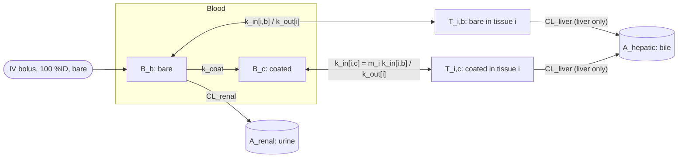
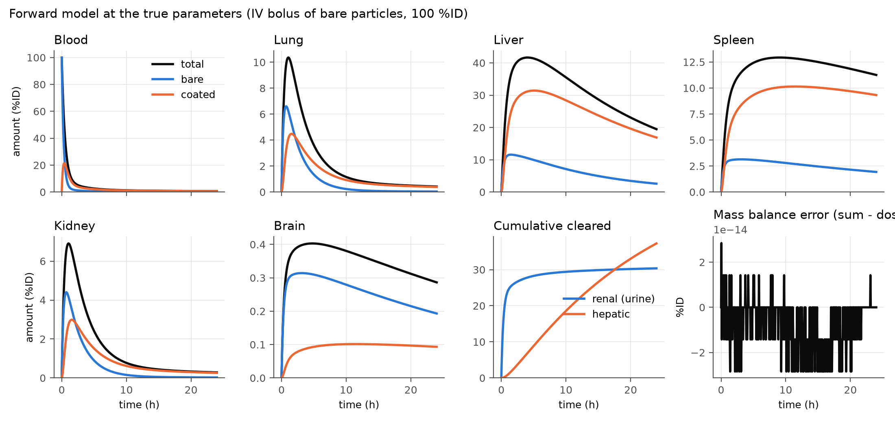
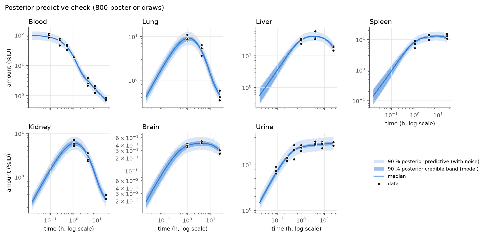
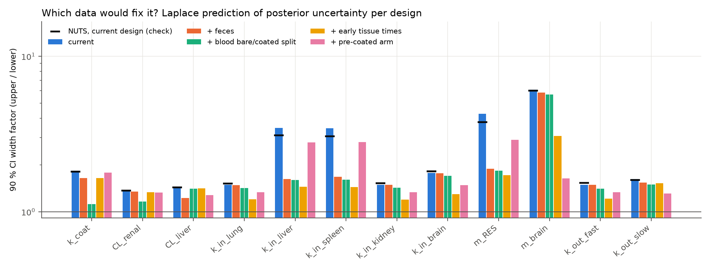
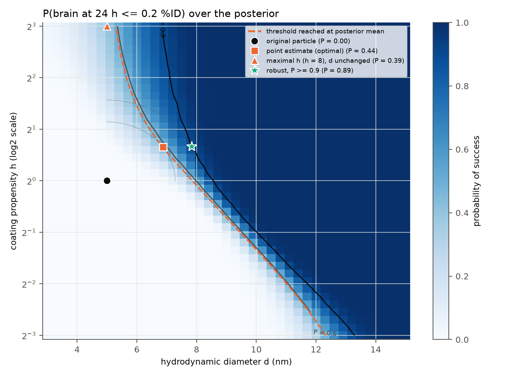

# Metamorph

Bayesian calibration and counterfactual design of a multi-compartment model for
nanoparticle transport, where the particle changes state as it circulates.

## Motivation

A nanoparticle injected into the blood does not stay the particle that was
designed. Within minutes, plasma proteins adsorb on its surface and form a
corona, and over the following hours this corona matures. The coated particle
is recognized differently by macrophages, crosses biological barriers
differently, and is no longer filtered by the kidney. Where a particle ends up
therefore depends not only on its initial properties but on how fast it
changes state, and on how each state interacts with each organ. Metamorph is a
deliberately small, fully reproducible study of this problem: a compartmental
ODE model with a bare and a coated state, calibrated by Bayesian inference on
sparse synthetic biodistribution data, analysed for identifiability and
sensitivity, and used to answer a design question (which change of particle
properties reduces brain accumulation) under posterior uncertainty.

What the repository demonstrates:

| Skill | Where |
|---|---|
| ODE / dynamical systems modelling | `src/metamorph/model.py`: JAX + diffrax, independent SciPy reference, exact solution, mass-balance tests |
| Bayesian inference in a probabilistic programming framework | `src/metamorph/inference.py`: NumPyro, NUTS, prior and posterior predictive checks, ArviZ diagnostics |
| Identifiability, experimental design, global sensitivity | `src/metamorph/sensitivity.py`: Fisher information (Laplace), Sobol indices |
| Counterfactual reasoning and optimization under uncertainty | `src/metamorph/counterfactual.py`: point-estimate and chance-constrained designs |
| Documented, packaged, tested scientific software | `pyproject.toml` (src layout), 32 tests, one script per phase, fixed seeds |

## Model



Tissues i: lung, liver, spleen, kidney, brain. Amounts in percent of injected
dose (%ID), time in hours, rates in 1/h. 14 states:

```
dB_b/dt       = -k_coat B_b - sum_i k_in[i,b] B_b + sum_i k_out[i] T_i,b - CL_renal B_b
dB_c/dt       =  k_coat B_b - sum_i k_in[i,c] B_c + sum_i k_out[i] T_i,c
dT_i,s/dt     =  k_in[i,s] B_s - k_out[i] T_i,s - [i = liver] CL_liver T_i,s
dA_renal/dt   =  CL_renal B_b
dA_hepatic/dt =  CL_liver (T_liver,b + T_liver,c)
```

12 free parameters (true values used to generate the synthetic data):

| Parameter | True value | Role |
|---|---|---|
| k_coat | 1.5 | effective coating rate in blood (bare to coated) |
| CL_renal | 0.8 | renal filtration of bare particles |
| CL_liver | 0.05 | hepatobiliary elimination from the liver |
| k_in_lung, k_in_liver, k_in_spleen, k_in_kidney, k_in_brain | 0.3, 0.4, 0.1, 0.2, 0.01 | uptake of bare particles |
| m_RES | 3.0 | coated / bare uptake ratio, liver and spleen |
| m_brain | 0.3 | coated / bare uptake ratio, brain |
| k_out_fast | 0.5 | return to blood from lung and kidney |
| k_out_slow | 0.03 | return to blood from liver, spleen and brain |

## Installation and reproduction

Python 3.11.

```
python -m venv .venv
.venv/Scripts/activate              # Windows; use: source .venv/bin/activate on Linux/macOS
pip install -e .[dev]
pytest                              # 32 tests, about 2 min
python scripts/run_all.py           # every figure and number, about 17 min on a laptop CPU
```

`run_all.py` runs the five phase scripts in order; each can also be run alone
(`python scripts/phaseN_*.py`). Figures go to `figures/`, numbers to
`results/`. All seeds are fixed. A guided tour is in `notebooks/demo.ipynb`
(requires the outputs of `run_all.py`; install the extra `pip install -e .[notebook]`).

## Results

Every number below is written to a text file in `results/` by the script of
the corresponding phase.

### 1. Forward model (`results/phase1_summary.txt`)



The JAX/diffrax solution, the SciPy reference and the exact solution
expm(A t) y0 agree to 5.3e-8 %ID; the total mass, including cleared amounts,
equals the dose to 2.8e-14 %ID. At 24 h the brain holds 0.286 %ID, two thirds
of it from bare particles that entered early, before coating.

### 2. Synthetic experiment (`results/phase2_summary.txt`)

Totals (bare and coated are not separable), 3 independent replicates,
multiplicative log-normal noise with sigma = 0.2, 87 measurements:

| Observable | Sampling times (h) |
|---|---|
| Blood (B_b + B_c) | 5/60, 15/60, 30/60, 1, 4, 8, 24 |
| Urine (cumulative A_renal) | 5/60, 15/60, 30/60, 1, 4, 8, 24 |
| Lung, liver, spleen, kidney, brain | 1, 4, 24 (organ harvesting is terminal) |

A_hepatic is not observed. Early blood and urine points are what separates
k_coat from CL_renal: across sampling times, the correlation between their
local sensitivity profiles is -0.74 with the early points and -0.945 without
them.

### 3. Bayesian calibration (`results/phase3_summary.txt`)

Log-normal priors from order-of-magnitude reasoning (medians deliberately not
equal to the true values), sampled in standardized log space. NUTS, 4 chains of
1000 warmup and 1000 draws, dense mass matrix: 0 divergent transitions, max
R-hat 1.000, min bulk ESS 2450. The dense mass matrix reduced the number of
leapfrog steps per iteration from 58.3 to 8.6 (`results/phase3_mass_matrix.txt`).
93.1 % of the data points lie inside the 90 % posterior predictive band.



| Parameter | True | Prior median | Posterior mean | 90 % CI | True in CI |
|---|---|---|---|---|---|
| k_coat | 1.5 | 1 | 1.92 | [1.39, 2.51] | yes |
| CL_renal | 0.8 | 0.5 | 0.921 | [0.785, 1.07] | yes |
| CL_liver | 0.05 | 0.1 | 0.0529 | [0.0438, 0.0625] | yes |
| k_in_lung | 0.3 | 0.2 | 0.256 | [0.207, 0.313] | yes |
| k_in_liver | 0.4 | 0.2 | 0.338 | [0.177, 0.54] | yes |
| k_in_spleen | 0.1 | 0.2 | 0.087 | [0.045, 0.139] | yes |
| k_in_kidney | 0.2 | 0.2 | 0.166 | [0.134, 0.205] | yes |
| k_in_brain | 0.01 | 0.01 | 0.0118 | [0.0085, 0.0153] | yes |
| m_RES | 3 | 2 | 4.1 | [1.99, 7.5] | yes |
| m_brain | 0.3 | 0.5 | 0.373 | [0.131, 0.775] | yes |
| k_out_fast | 0.5 | 0.3 | 0.434 | [0.35, 0.535] | yes |
| k_out_slow | 0.03 | 0.05 | 0.0349 | [0.0273, 0.0437] | yes |
| sigma | 0.2 | HalfNormal(0.5) | 0.196 | [0.171, 0.224] | yes |

The full table with posterior medians, R-hat and ESS is in
`results/phase3_parameter_table.md`.

### 4. Identifiability and sensitivity (`results/phase4_summary.txt`)

**Posterior correlations (log space).** The strongest are k_in_liver with m_RES
(r = -0.97) and k_in_brain with m_brain (r = -0.84): tissues are first sampled
at 1 h, when most circulating particles are already coated, so the data
determine the products k_in * m but not each factor. k_coat and CL_renal are
correlated (r = +0.79) through the urinary plateau. A k_out_slow / CL_liver
non-identifiability anticipated at the design stage did not materialize
(r = +0.29), because k_out_slow is shared with spleen and brain, which have no
clearance.

**Which data would fix it.** A Laplace (Fisher information) approximation,
validated against NUTS on the actual design (median difference in posterior
standard deviation 4 %), predicts the 90 % credible interval width factor
(upper / lower) under alternative designs:

| Parameter | Current | + feces | + blood bare/coated split | + early tissue times | + pre-coated arm |
|---|---|---|---|---|---|
| k_coat | 1.84 | 1.65 | 1.12 | 1.65 | 1.78 |
| k_in_liver | 3.46 | 1.62 | 1.60 | 1.45 | 2.80 |
| m_RES | 4.27 | 1.89 | 1.84 | 1.72 | 2.89 |
| m_brain | 6.10 | 5.85 | 5.67 | 3.08 | 1.64 |



Early information on bare-particle uptake fixes m_RES; only a second arm with
pre-coated particles fixes m_brain.

**Global sensitivity.** Sobol indices of log10 amounts at 24 h, inputs varied
over the prior (57,344 model runs). Brain: k_in_brain (S1 0.50), k_out_slow
(0.17), then m_brain, k_in_liver and CL_renal (about 0.06 each); k_coat acts
only through interactions (S1 about 0, ST 0.03). Liver: CL_liver (S1 0.57),
k_in_liver (0.11), CL_renal (0.08). Brain accumulation is decided first by
barrier permeability and retention, then by the competition of the clearing
organs for circulating particles.

### 5. Counterfactual design (`results/phase5_summary.txt`)

Two interpretable properties are mapped to rates (`src/metamorph/properties.py`),
relative to the calibrated reference particle (diameter d = 5 nm, coating
propensity h = 1):

```
CL_renal(d)   = CL_renal   * sigmoid((6 - d) / 0.7) / sigmoid((6 - 5) / 0.7)
k_in_brain(d) = k_in_brain * exp(-(d - 5) / 4)
k_coat(h)     = k_coat     * h
```

**Question.** The reference particle holds 0.294 %ID in the brain at 24 h
(posterior mean; 90 % interval [0.256, 0.351]). What is the smallest change of
(d, h), in the normalized distance sqrt(u^2 + v^2) with u = (d - 5 nm) / 2 nm
and v = log2(h), that brings it below 0.2 %ID? The probability of success is
evaluated on 3000 posterior draws held out from the 1000 used for optimization.

| Candidate | d (nm) | h | Distance | Brain at posterior mean (%ID) | P(success) |
|---|---|---|---|---|---|
| Original particle | 5.00 | 1.00 | 0 | 0.294 | 0.000 |
| Point-estimate counterfactual | 6.87 | 1.57 | 1.14 | 0.200 | 0.441 |
| Coating propensity only, h = 8 | 5.00 | 8.00 | 3.00 | 0.214 | 0.386 |
| Robust counterfactual, P >= 0.9 | 7.83 | 1.59 | 1.57 | 0.165 | 0.891 |



The point-estimate counterfactual meets the threshold at the posterior mean but
succeeds for only 44 % of the plausible parameter values: it should not be
trusted. Changing h alone cannot reach the threshold at the posterior mean,
and its effect is very uncertain because it acts through the poorly identified
m_brain. The robust counterfactual moves further, and mainly along d, which
acts through well-identified parameters (CL_renal, k_in_brain): uncertainty
changes the direction of the answer, not only its size. The robust design
reaches P = 0.900 on the optimization draws and 0.891 on the held-out draws,
the small gap being the expected optimism of optimizing on a finite sample.
Because the model is linear, these evaluations use the exact solution
expm(A t) y0, about 40 times faster than the adaptive solver (agreement with
diffrax is tested).

## Model assumptions and limitations

1. **Effective coating rate.** `k_coat` is an effective rate for a functional
   change of state, namely the maturation of the hard protein corona that alters
   macrophage recognition and barrier crossing. It is deliberately slower than
   the initial protein adsorption, which happens within minutes, so that both
   states are visible on the time scale of the measurements.
2. **Irreversible coating, in blood only.** Particles do not lose their corona,
   and particles taken up by a tissue keep the state they had on entry.
3. **Linear kinetics.** All fluxes are first order in the amount: no saturation
   of macrophage uptake, no dose dependence.
4. **Amounts, not concentrations.** Organ volumes and blood flows are not
   represented; each rate constant lumps perfusion, permeability and binding.
   This is not a physiologically based (PBPK) model, and the rates do not
   transfer between species.
5. **Grouped parameters for identifiability.** Coated uptake is
   `k_in[i,c] = m_i k_in[i,b]`, with one multiplier `m_RES` shared by liver and
   spleen, a free `m_brain`, and `m_lung = m_kidney = 1`. Return rates are
   grouped as `k_out_fast` (lung, kidney) and `k_out_slow` (liver, spleen, brain).
6. **Clearance routes.** Renal filtration acts on bare particles in blood only;
   hepatic clearance acts on both states in the liver. No other elimination
   route is modelled.
7. **Closed mass balance.** Cleared amounts are tracked in two cumulative states,
   so the total amount equals the dose at all times.
8. **Independent replicates.** Measurement errors are independent across
   replicates and times; inter-individual variability and within-animal
   correlation of serial blood samples are not modelled.
9. **One noise scale.** The same log-scale noise applies to all observables.
10. **Property maps.** Renal filtration has a soft size cutoff near 6 nm;
    brain uptake decreases exponentially with size (decay length 4 nm); the
    coating rate is proportional to the coating propensity h. The constants
    are treated as known, and d and h affect nothing else (in reality size
    also changes liver and spleen uptake, and surface chemistry changes the
    coated-state multipliers).
11. **Design distance.** A change is measured as sqrt(u^2 + v^2) with
    u = (d - 5 nm) / 2 nm and v = log2(h). The optimal direction depends on
    this choice of scales, which in practice should reflect manufacturing cost.
12. **Synthetic data, correct model.** Data are generated by the same model
    structure that is fitted (with a different solver), so model
    misspecification is not tested. The probabilities of success are
    conditional on the model, the priors and the property maps.

## Future work

- **Real data.** Calibrate on published or tissue-on-chip biodistribution data;
  add a hierarchical (population) layer for inter-individual variability and
  separate noise scales for blood, urine and tissues.
- **Learned property maps.** Replace the assumed maps by maps calibrated on
  several particles of different size and surface chemistry, with priors on
  their constants propagated into P(success).
- **Surrogate model.** For nonlinear extensions (saturable uptake, reversible
  coating), the exact matrix exponential no longer applies; a Gaussian process
  emulator of the ODE output, with its own uncertainty, would keep the
  counterfactual search fast.
- **PBPK physiology.** Organ volumes and blood flows, so that rates become
  transferable between species and doses.
- **Bayesian experimental design.** Choose the next experiment (for example the
  pre-coated arm) by expected information gain, then update the posterior with
  its result.
- **Structural identifiability.** Complement the practical analysis with a
  symbolic or profile-likelihood analysis.

## Repository structure

```
src/metamorph/
  model.py           ODE system, parameters, diffrax / SciPy / exact solvers
  data.py            observation design, noise model, dataset I/O
  inference.py       NumPyro model, priors, NUTS, predictive checks
  sensitivity.py     Fisher information designs, Sobol indices, elasticities
  properties.py      particle properties (d, h) to rate constants
  counterfactual.py  point-estimate and robust counterfactual design
  plotting.py        shared plotting style and trajectory figure
scripts/             one script per phase, and run_all.py
tests/               pytest suite (32 tests)
notebooks/demo.ipynb guided tour
data/                synthetic dataset and true parameters
figures/, results/   outputs of the scripts
docs/                parameter proposal and learning notes (in French)
```

## References

1. Monopoli MP, Aberg C, Salvati A, Dawson KA. Biomolecular coronas provide the
   biological identity of nanosized materials. *Nature Nanotechnology* 7,
   779-786 (2012).
2. Tenzer S, et al. Rapid formation of plasma protein coronas critically affects
   nanoparticle pathophysiology. *Nature Nanotechnology* 8, 772-781 (2013).
3. Choi HS, et al. Renal clearance of quantum dots. *Nature Biotechnology* 25,
   1165-1170 (2007).
4. Wilhelm S, et al. Analysis of nanoparticle delivery to tumours. *Nature
   Reviews Materials* 1, 16014 (2016).
5. Li M, Al-Jamal KT, Kostarelos K, Reineke J. Physiologically based
   pharmacokinetic modeling of nanoparticles. *ACS Nano* 4, 6303-6317 (2010).
6. Hoffman MD, Gelman A. The No-U-Turn Sampler: adaptively setting path lengths
   in Hamiltonian Monte Carlo. *Journal of Machine Learning Research* 15,
   1593-1623 (2014).
7. Phan D, Pradhan N, Jankowiak M. Composable effects for flexible and
   accelerated probabilistic programming in NumPyro. arXiv:1912.11554 (2019).
8. Kidger P. On Neural Differential Equations. PhD thesis, University of
   Oxford (2021). (diffrax)
9. Kumar R, Carroll C, Hartikainen A, Martin O. ArviZ a unified library for
   exploratory analysis of Bayesian models in Python. *Journal of Open Source
   Software* 4, 1143 (2019).
10. Vehtari A, Gelman A, Simpson D, Carpenter B, Burkner PC. Rank-normalization,
    folding, and localization: an improved R-hat for assessing convergence of
    MCMC. *Bayesian Analysis* 16, 667-718 (2021).
11. Gabry J, Simpson D, Vehtari A, Betancourt M, Gelman A. Visualization in
    Bayesian workflow. *Journal of the Royal Statistical Society A* 182,
    389-402 (2019).
12. Raue A, et al. Structural and practical identifiability analysis of
    partially observed dynamical models by exploiting the profile likelihood.
    *Bioinformatics* 25, 1923-1929 (2009).
13. Sobol IM. Global sensitivity indices for nonlinear mathematical models and
    their Monte Carlo estimates. *Mathematics and Computers in Simulation* 55,
    271-280 (2001).
14. Saltelli A, et al. Variance based sensitivity analysis of model output.
    Design and estimator for the total sensitivity index. *Computer Physics
    Communications* 181, 259-270 (2010).
15. Jansen MJW. Analysis of variance designs for model output. *Computer
    Physics Communications* 117, 35-43 (1999).
16. Charnes A, Cooper WW. Chance-constrained programming. *Management Science*
    6, 73-79 (1959).
17. Pearl J. *Causality: Models, Reasoning, and Inference*, 2nd ed. Cambridge
    University Press (2009).
18. Kennedy MC, O'Hagan A. Bayesian calibration of computer models. *Journal of
    the Royal Statistical Society B* 63, 425-464 (2001).

## License

MIT, see `LICENSE`.
